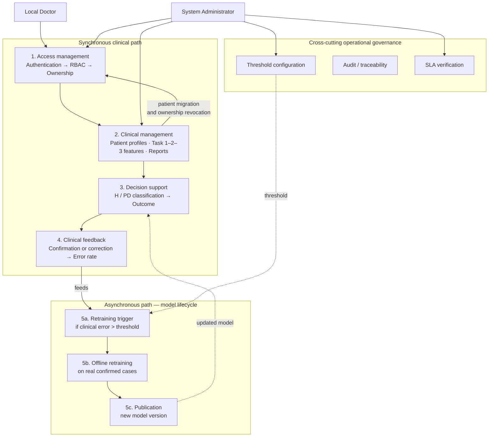

# Functional Architecture — Parkinson Classifier SaaS

**Functional** view

Does not describe services, subnets, or protocols.

The diagram has **two paths** and a cross-cutting governance block.

## How to Read It

1. **Synchronous (1→4):** what the doctor does in session, up to feedback on the prediction.
2. **Asynchronous (5a→5c):** retraining outside the online path; the new model returns only to classification.
3. **Governance:** thresholds, audit, and SLAs do not interrupt the clinical flow; the admin configures and monitors.

## Summary Legend

| Block | What It Offers | Who Uses It |
| --- | --- | --- |
| 1. Access management | login, roles, ownership | Doctor, Admin |
| 2. Clinical management | patients, features, reports, migration | Doctor (usage); Admin (migration) |
| 3. Decision support | H/PD prediction | Doctor |
| 4. Clinical feedback | confirmation/correction → error rate | Doctor |
| 5. Model lifecycle | trigger, training, publication | System (Admin monitors) |
| Governance | thresholds, audit, SLA | Admin |