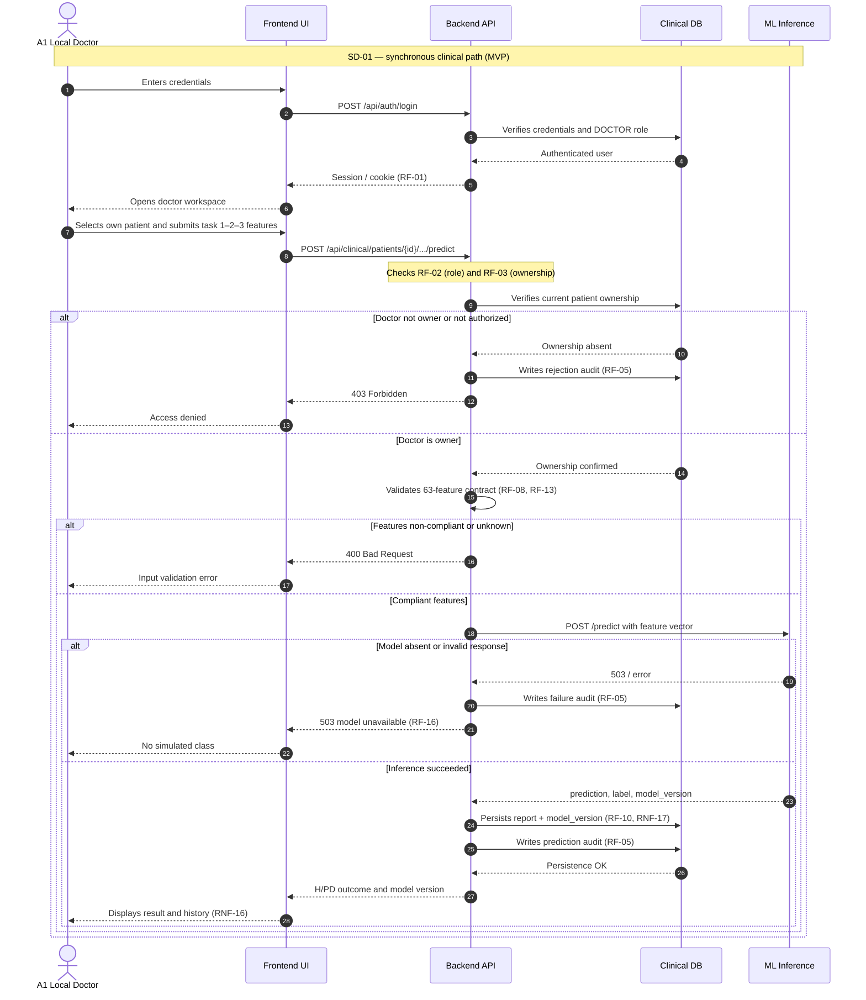
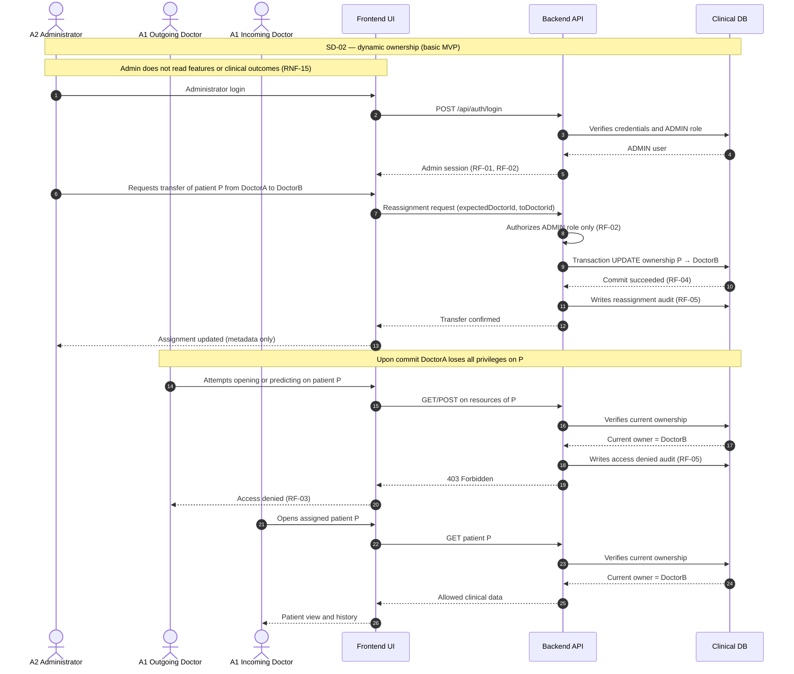

# Requirements Specification — Parkinson Classifier SaaS

## 1. Context and Objective

The platform is a SaaS service supporting binary classification **H** (Healthy) / **PD** (Parkinson's Disease) based on PaHaW graphomotor features. It is an educational project for Secure Cloud Computing: **not** a clinically validated diagnostic device. The MVP is a web application integrated with a database and an already-trained ML model, deployed in a local containerized environment; the reference architecture is broader and includes separate services, high availability, retraining, and scaling.

## 2. System Boundary and Actors

The boundary of the UML diagrams is **the entire Parkinson Classifier SaaS platform** (UI, backend, database, inference service, and automated processes). **External actors:**

* **A1 — Local Doctor:** works exclusively on patients under their ownership, inputs features, views predictions, and optionally confirms/corrects results.
* **A2 — System Administrator (application role):** manages reassignments, configuration, and monitoring; cannot view cleartext clinical data through the application role.

The **ML engine is internal** to the system and does not appear as an actor; similarly, NGINX, database, retraining worker, and scheduler are internal components. An *ML Engineer* becomes an actor only in a separate diagram of the offline training procedure, with a different boundary.

## 3. Scope

**Implemented / to-be-completed MVP:** login; 2-role RBAC and ownership; patient UI and feature form; prediction via API; history/reports and basic audit; a relational database; Docker and local Kubernetes deployment; NGINX/TLS/rate limit; Docker Scout and `wrk` tests.

**Architectural design only:** separate microservices, East-West mTLS, actual VPC and subnets, ASL and custom autoscaling, primary/replica database and full failover, dedicated registry, WAF, SLA monitor, asynchronous triggered training and hot swap; full end-to-end GDPR.

**Legend:** **Must** = necessary requirement within the indicated scope; **Should** = desirable; **Arch.** = designed, not necessarily implemented; **Basic MVP** = simplified version actually demonstrable.

## 4. Functional Requirements (FR)

| ID | Category | Verifiable Requirement | Priority | Scope | Verification/Acceptance |
| --- | --- | --- | --- | --- | --- |
| RF-01 | Authentication | The system must allow Doctor and Administrator to authenticate and manage a session/token with expiration. | Must | MVP | Valid/invalid login and expiration verifiable. |
| RF-02 | Role-based Authorization | The backend must distinguish Doctor and Administrator and authorize each operation according to the role. | Must | MVP | A role lacking permission receives a rejection even when calling the API directly. |
| RF-03 | Ownership Isolation | The Doctor must view and modify only the data of patients of whom they are the owner at the time of the request. | Must | MVP | No data of patient B leaks to doctor A in list, detail, report, or prediction. |
| RF-04 | Patient Reassignment | The Administrator must be able to reassign a patient to another Doctor; ownership is verified on every operation, and revocation takes effect upon commit. | Must | Basic MVP; Arch. for full workflow | After reassignment, the former doctor can no longer access the patient. |
| RF-05 | Audit Trail | The system must log at least authentications, relevant accesses, predictions, and reassignments with actor, event, timestamp, and outcome. | Must | Basic MVP | Events viewable in protected form, without tokens or superfluous clinical data. |
| RF-06 | Patient Management | The Doctor must be able to create, list, view, and update the demographics of their own patients; deletion must be governed separately. | Must | Basic MVP | Operations allowed only on own records and validated server-side. |
| RF-07 | Input for Allowed Tasks | The Doctor must be able to enter the feature vector referring exclusively to PaHaW tasks 1, 2, and 3. | Must | MVP | The form uses the features specified by the JSON contract. |
| RF-08 | Feature Validation | The API must reject unexpected keys or non-compliant values and apply an explicit policy on missing values. | Must | MVP | Unknown feature → error; missing/NaN policy defined and tested. |
| RF-09 | Prediction Request | An authorized Doctor must be able to request an H/PD classification on the selected patient. | Must | MVP | Valid request with available model returns compliant class. |
| RF-10 | Result Recording | A valid prediction must produce a persisted report associated with the patient, with timestamp and model version. | Must | MVP | Report available in the history of the correct patient. |
| RF-11 | Clinical Feedback | The Doctor should be able to confirm or report an error on a prediction for their patient. | Should | Arch.; Optional MVP | Feedback linked to the specific prediction and doctor. |
| RF-12 | Prediction History | The Doctor should be able to view the history of reports/predictions of their own patients. | Should | MVP | Search and detail respect ownership. |
| RF-13 | Versioned ML I/O Contract | The system must adopt the canonical set of 63 features from the schema file, vectorized in deterministic order by the server, and document the request/response format. | Must | MVP | Schema–pipeline–API correspondence, automatable test. |
| RF-14 | ML Pipeline | The pipeline must include imputation, standardization, filter feature selection (Mutual Information), and classifier. | Must | MVP | Serialized bundle includes all trained steps. |
| RF-15 | No Synthetic Augmentation | Training must use only real cases foreseen by the scope, without synthetic generation of samples. | Must | MVP / Arch. | Training procedure documented and reproducible. |
| RF-16 | Inference on Serialized Model | In real mode, the API must perform inference with a compatible joblib bundle, rejecting a request when the model is unavailable. | Must | MVP | No demo prediction passed off as a real model. |
| RF-17 | Conditional Retraining | The designed system should trigger an asynchronous process when validated clinical error exceeds the configured threshold. | Should | Arch. Only | Trigger and conditions described; not required in the demo. |
| RF-18 | Zero-Downtime Model Update | The designed system should publish a new version and allow switching to the active model without interrupting inference. | Should | Arch. Only | Rollback/hot-swap flow described. |
| RF-19 | Model/Data Separation | ML artifacts must be stored separately from identifying clinical data, with distinct permissions. | Must | Basic MVP / Arch. | Bundle outside the clinical database; consistent permissions. |
| RF-20 | Web App with DB | The prototype must provide UI and API integrated with a relational database for users, patients, and reports. | Must | MVP | Login→patient→prediction→history flow executable. |
| RF-21 | Container and Deployment | The prototype must be containerized via Docker and run in a local Kubernetes cluster with at least one control plane and one worker. | Must | MVP | Manifests, images, and startup procedure reproducible. |
| RF-22 | Secure Reverse Proxy | External access must go through NGINX with HTTPS/TLS termination and documented rate limiting. | Must | MVP | TLS test, routing, and response upon threshold exceedance. |
| RF-23 | Vulnerability Analysis | Images must be analyzed with Docker Scout; fixable vulnerabilities must be mitigated and results compared/documented. | Must | MVP | Before/after report and rationale for residual CVEs. |

## 5. Non-Functional Requirements (NFR)

| ID | Quality/Constraint | Objective | Scope | Verification/Evidence |
| --- | --- | --- | --- | --- |
| RNF-01 | Prediction Latency | End-to-end ≤ 1 s during the operational window, at reference load. | Arch. target; MVP local measurement | Timing and percentile tests with explicit methodology. |
| RNF-02 | Peak Capacity | Sustain up to 5,000 requests/minute. | Arch. target; MVP local benchmark | Observed throughput and gap toward target declared. |
| RNF-03 | User Sizing | Design for approximately 50,000 total clients/users. | Arch. Only | Sizing assumptions and simulation documented. |
| RNF-04 | Service Window | Monday–Friday 08:00–18:00. | Arch. | Window and time zone specified in SLA. |
| RNF-05 | Availability and Reliability | Target availability and reliability ≥ 99.5% within the service window. | Arch. Only | SLA defined with measurement criteria, not claimed verified on laptop. |
| RNF-06 | Fault Recovery | Recovery/failover expected within 3 minutes for critical components. | Arch. Only | Failover scenario and preconditions described. |
| RNF-07 | Retraining Resource Isolation | Retraining must not degrade the synchronous path; separate resources. | Arch. Only | Resource pools or limits in the design. |
| RNF-08 | Pod Self-Healing | The prototype must demonstrate observable recovery of an application Pod after failure. | MVP | Pod restart and endpoint resumption demo. |
| RNF-09 | Perimeter Security | External requests must use HTTPS/TLS via NGINX. | MVP / Arch. | Valid TLS negotiation and HTTP explicitly handled. |
| RNF-10 | Internal Traffic Protection | mTLS for inter-service channels designed in the private subnet. | Arch. Only | Trust design, certificates, and termination actors. |
| RNF-11 | Data Encrypted at Rest | Encryption at rest of clinical data, backups, and sensitive artifacts. | Arch.; MVP document limits | Mechanisms/limits and responsibilities indicated. |
| RNF-12 | DoS Defense and WAF | Rate limiting in the MVP; WAF at the architectural level. | MVP rate; Arch. WAF | Thresholds, responses, and limits tested/declared. |
| RNF-13 | ML Artifact Separation | Registry/model bundles separated from identifiable clinical data. | Basic MVP / Arch. | Paths and permissions documented. |
| RNF-14 | Data Protection and Right to Erasure | Design record deletion upon legitimate request and exclusion from future retraining; evaluate effects on already trained models. | Arch. Only | Deletion process and explicit limits. |
| RNF-15 | Administrator Privileges | The Admin application role must not be able to view cleartext clinical data. | MVP / Arch. | Admin API and UI without clinical access; infrastructure privileges evaluated separately. |
| RNF-16 | Result Usability | Form and response must clearly distinguish H/PD and display a non-diagnostic disclaimer. | MVP | Understandable flow and results not presented as a diagnosis. |
| RNF-17 | Model Traceability | Every response/report must include `model_version` or another unambiguous version ID. | MVP | Version visible and persisted in the report. |
| RNF-18 | Project Traceability | Every architectural block must be labeled implemented/approximated/designed. | Deliverable | Component matrix attached. |
| RNF-19 | AI Usage Tracking | Log substantial AI-assisted activities with human review. | Deliverable | AI logs updated and accessible. |
| RNF-20 | Feature Perimeter | Only tasks 1–2–3 (spiral, “l”, “le”). | MVP | Schema with 63 names and corresponding tasks. |
| RNF-21 | Filter Feature Selection | Selection via Mutual Information, inside cross-validation. | MVP | Verifiable code pipeline; no leakage in CV. |
| RNF-22 | Model Validation | Model selection based on CV on train, not on the final test set. | MVP | Train/CV/test report and selection criterion documented. |
| RNF-23 | ML Baseline | Linear SVM used as initial demo model, with subsequent updates only if designed/approved. | MVP | Model and version explicitly stated in the demo. |

## 6. Minimum MVP Acceptance Criteria

1. An authenticated doctor cannot obtain patient information belonging to another doctor via either UI or API, including lists, reports, and predictions.
2. A schema-compliant input from an authorized doctor produces a `prediction`, `label`, `model_version` response **when the real model is loaded**. Absence of the model: explicit error, not a plausible placeholder prediction.
3. The contract establishes 63 allowed names, only from tasks 1–2–3. Unknown inputs are rejected; a policy for missing/null keys is formalized.
4. The prediction and model version are saved on the correct patient and appear in the history.
5. The app runs in Docker/Kubernetes behind NGINX with HTTPS and rate limiting; build and deployment documented.
6. Docker Scout scan with before/after evidence, any residual vulnerabilities, and rationale.
7. `wrk` produces repeatable metrics (throughput, latency, errors, and load parameters); the report distinguishes the local result from the architectural SLA.
8. Upon deleting an application Pod, the service becomes available again through the configured Kubernetes mechanisms (demo scenario).

## 7. System Behavior — Sequence Diagrams

This section shows how the MVP components interact in the two main use cases. The diagrams use the system boundary from §2 (external actors A1/A2; ML and DB as internal components).

### 7.1 SD-01 — End-to-End Clinical Prediction

**Title:** Doctor authentication, ownership, feature validation, inference, and report persistence

**Objective:** trace the synchronous path from login to H/PD outcome saved in history.

**Covered requirements:** RF-01, RF-02, RF-03, RF-05, RF-07, RF-08, RF-09, RF-10, RF-13, RF-16, RF-20; RNF-16, RNF-17.

**Acceptance criteria (§6):** 1, 2, 3, 4.

### 7.2 SD-02 — Patient Reassignment and Immediate Ownership Revocation

**Title:** Administrative transfer, atomic commit, former doctor access attempt, and new owner access

**Objective:** demonstrate multi-tenant isolation and immediate revocation after reassignment, without exposing clinical data to the admin.

**Covered requirements:** RF-01, RF-02, RF-03, RF-04, RF-05; RNF-15.
**Note**

actor DoctorA as A1 Outgoing Doctor
actor DoctorB as A1 Incoming Doctor

**Acceptance criteria (6):** 1 (also after transfer).

